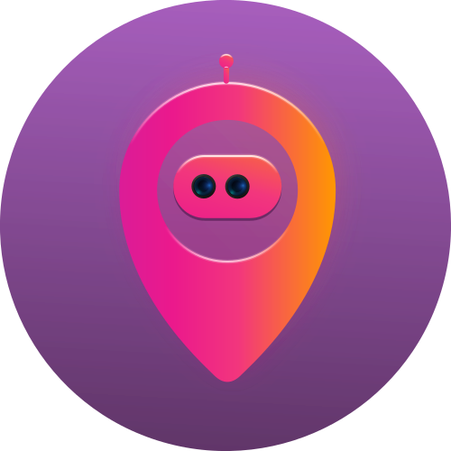
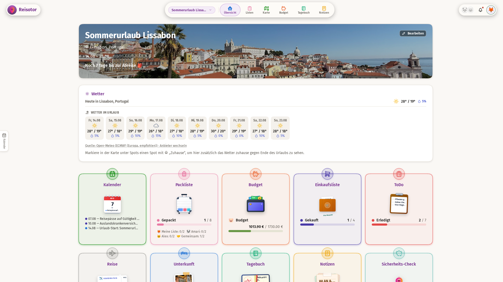
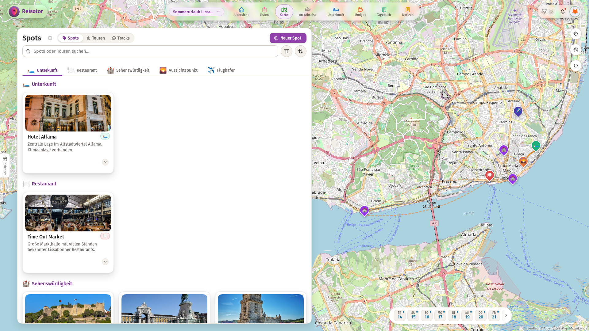
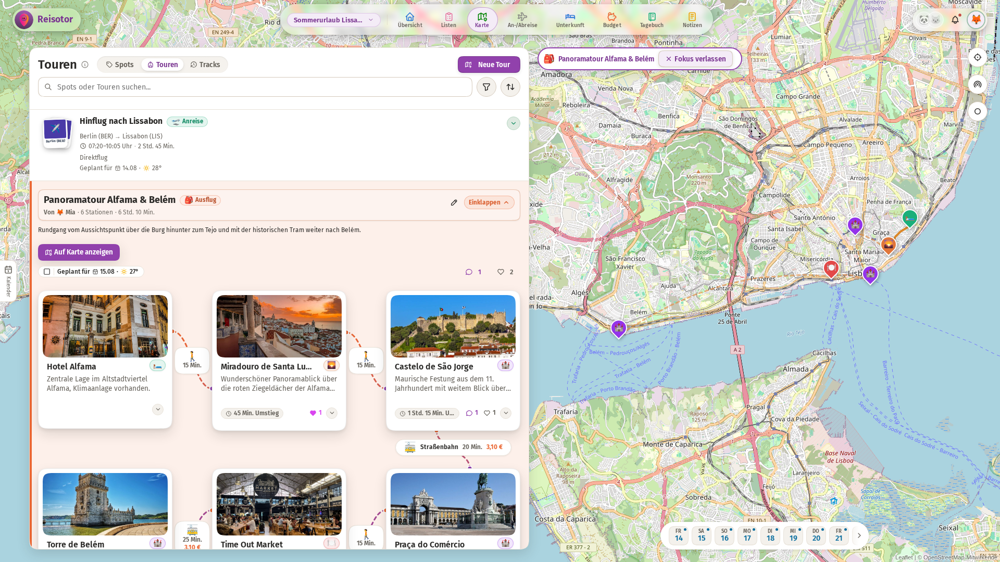
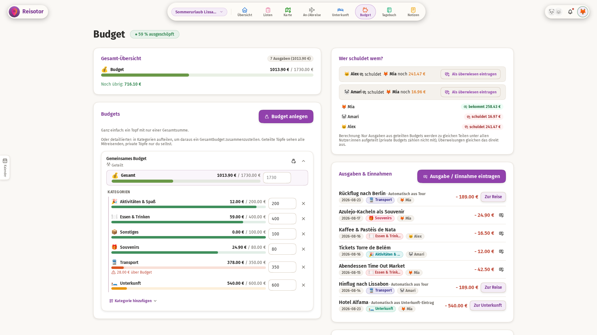
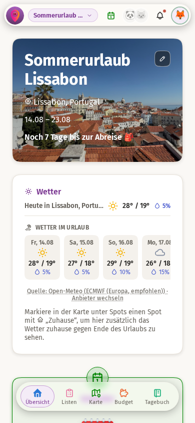
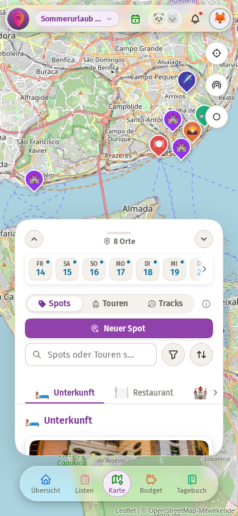
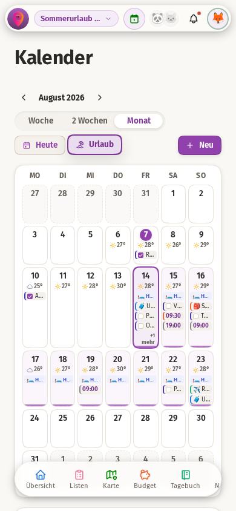

<p align="center">
  
</p>

# 🎒🤖 Reisotor

Web-App zur gemeinsamen Reiseplanung – ein zentraler Ort für alles rund um Deine Reise.

[🌍👉 Demo 👈🎒](https://dmstern.github.io/reisotor/)

<p align="center">
  <picture>
    <source media="(prefers-color-scheme: dark)" srcset="./docs/screenshots/dashboard-desktop-dark.png">
    
  </picture>
</p>

## 📸 Eindrücke

<details open>
<summary><b>🗺️ Spots, Touren & Entdeckungen auf der Karte</b></summary>
<br />

<p align="center">
  <picture>
    <source media="(prefers-color-scheme: dark)" srcset="./docs/screenshots/spots-desktop-dark.png">
    
  </picture>
</p>

<p align="center">
  <picture>
    <source media="(prefers-color-scheme: dark)" srcset="./docs/screenshots/tour-desktop-dark.png">
    
  </picture>
</p>
</details>

<details>
<summary><b>📅 Kalender, Zeitplan & Tagesablauf</b></summary>
<br />

<p align="center">
  <picture>
    <source media="(prefers-color-scheme: dark)" srcset="./docs/screenshots/calendar-desktop-dark.png">
    
  </picture>
</p>
</details>

<details>
<summary><b>💶 Gemeinsames Budget & transparente Abrechnung</b></summary>
<br />

<p align="center">
  <picture>
    <source media="(prefers-color-scheme: dark)" srcset="./docs/screenshots/budget-desktop-dark.png">
    
  </picture>
</p>
</details>

<details>
<summary><b>📱 Unterwegs auf dem Smartphone (Responsive & Offline-PWA)</b></summary>
<br />

<p align="center">
  
  
  
</p>
</details>

## Features

- 🏠 **Übersicht/Dashboard**: Intuitiver Schnellüberblick mit Reise-Countdown, anstehenden Terminen, Packlisten- und Budgetstatus sowie Live-Wetter
- 🗺️ **Spots & interaktive Karte**: Spots (Sehenswürdigkeiten, Unterkünfte, Gastronomie) mit Geokoordinaten, Adressen, Google-Maps-Verknüpfung, Likes, Kommentaren, Besuchsstatus und interaktiver Leaflet/OpenStreetMap-Karte mit Emoji-Markern
- 🥾 **Touren & Teilstrecken**: Mehretappen-Touren mit Stationen, Teilstrecken (Verkehrsmittel, Fahr- & Umsteigezeiten, Sitzplätze, Ticketkosten), geschwungenen Serpentinen-Routen und Live-GPS-Track-Aufzeichnung direkt im Browser
- 📅 **Ablauf & Kalender**: Floating-Drawer auf Desktop und eigenständige Mobil-Ansicht; Wochenablauf, Termine, Fälligkeiten und Drag & Drop von Ausflügen
- 🌦️ **Wetter & Unwetterwarnungen**: 14-Tage-Wettervorhersage, stündlicher Tagesverlauf, wählbare Wettermodelle (z. B. DWD ICON) und automatische Warnhinweise bei Hitze, Sturm oder Starkregen
- 📋 **Zentrale Listen (Packliste, Einkauf, ToDos)**: Zusammengefasste Listen-Ansicht (`/listen`) mit Rollen, Fälligkeiten, Prioritäten und Zuweisungen
- 💶 **Gemeinsames Budget**: Ziel- und Kategorienbudgets, Ausgaben, Überweisungen und automatischer Schuldenausgleich (Splitwise-artig)
- 📔 **Tagebuch**: Reiseberichte mit Bildern, Reaktionen und Kommentaren
- 📝 **Notizen & Dateianhänge**: Rich-Text-Notizen (fett/kursiv/Listen/Links) und universeller Datei-Upload für Buchungsbestätigungen und Tickets
- 🌍 **Reiseregion-Infos**: Landessprache, lokale Währung inklusive tagesaktueller Wechselkurse zur Heimatwährung sowie Sicherheitshinweise
- 📍 **Live-Standort & Präsenz**: Optionale Live-Standortfreigabe für Mitreisende direkt auf der Karte sowie Online-Präsenz-Avatare im Header
- ⚡ **Echtzeit-Synchronisation**: SSE-basierter Live-Sync zwischen allen Mitgliedern – Änderungen erscheinen sofort ohne Neuladen
- 📴 **Offline-fähige PWA**: Vollständig als App installierbar (iOS/Android/Desktop), lokaler Cache und automatische Nachsynchronisation bei Verbindungsaufbau
- 🗑️ **Papierkorb mit Undo**: 60-Sekunden-Rückgängig-Funktion direkt an Ort und Stelle sowie dauerhafter Papierkorb zur Wiederherstellung
- 🎨 **Modernes Design**: Dark Mode & Light Mode, optimierte Glassmorphism-Oberflächen, Gestensteuerung und barrierefreie Kontraste
- 🛡️ **Nutzerverwaltung & Rechte**: Integrierte Admin-Kontoverwaltung, temporäre Passwörter, konfigurierbare Registrierung und ZIP-Vollbackups

## 🤖 Hintergrund & Motivation

Im Juli 2026 wollte ich vor allem eine coole App haben, mit der ich unseren Italien-Urlaub mit meiner Freundin planen kann. Statt Miro-Boards, Excel-Listen oder verstreuten Zettel sollte alles an einem Ort sein, was wir für Planung brauchten, wo wir Ideen festhalten konnten und auch während des Urlaub immer wieder rein schauen und kleine digitale Souvenirs speichern konnten.
Aber die meisten Apps, die man so findet, können entweder zu wenig oder zu viel oder eben nicht genau das, was ich brauchte. Außerdem laufen die in irgendeiner Cloud, wo niemand weiß, was mit den eigenen Daten passiert. Ich entwickle seit ca. 20 Jahren Webseiten (also seit dem Teenager-Alter). Und hätte ich keinen Vollzeitjob und jede Menge Freizeit, hätte sie vor ein paar Jahren vermutlich noch komplett selbst programmiert. Aber wir lebel gerade in einer aufregenden (und auch leicht dystopischen) Zeit, wo Nachrichten über sich selbstständig machende KI-Agenten fast schon zum Alltag gehören, aber man sich eben auch mit ein paar Prompts eine App nach eigenem Geschmack von einer KI zusammenzimmern lassen kann.
Und da ich eh schon lang mal dieses "agentic coding" ausprobieren wollte, hab kurzer Hand mal ein paar Euros in den Claude-Code-Slot geschmissen und drauf los gepromptet, meinen 14-Jahre alten RaspberryPi aus der Schublade geholt und ihm ein zweites Leben als kleinen Mini-Server für das Reisotor-Backend geschenkt.
Meine Freundin machte Augen als sie die erste Version sah. Ich bin großer Roboter-Fan seit meiner Kindheit und habe inzwischen auch meine Freundin damit angesteckt. Sie sagt, es muss natürlich "Robotor" heißen (mit Betonung auf der zweiten Silbe). Und so wurde aus dem kleinen Reise-Helfer natürlich der "Reisotor".
Er wurde also weiter gepflegt und mit Inhalten gefüttert und etwa eine Woche vor dem Urlaub hab ich dann schnell noch die mobile Claude App an das GitHub Repo angebunden, sodass ich auch im Urlaub zwischen Strand und Bar schnell noch ein paar Bugfix-Deployments hinterher schieben konnte.

In den Wochen nach dem Urlaub wurde kontinuierlich vor'm Schlafengehen und in der Mittagspause daran weiter gearbeitet, KI-Modelle ausprobiert, Prompt-Vorlagen schreiben lassen, Bugs gefixt, neue Features ausgedacht, große Refactoring-Läufe durch den Agenten gejagt, Security- und Quality-Gates eingeführt. Ich hab mich mit ständig viel zu früh aufgebrauchten Token-Limits rumgeschlagen und insgesamt viel zu viel Geld für KI-Abos ausgegeben (so viel hätte nie im Leben für eine App bezahlt haha). Aber dafür konnte ich so jetzt erste Erfahrung mit Agentic Coding sammeln, denn der Job als Entwickler verändert sich gerade so rasend schnell, dass man teilweise kaum noch mitkommt. Und so schnell wird das erstmal nicht wieder weg gehen.
Inzwischen arbeite ich mit Antigravity von Google, weil ich eh schon für Google Drive zahle und so kosteneffizienter bin als wenn ich mir noch ein Abo bei Anthropic oder OpenAI an die Backe nagel. Und werbefreies YouTube gibt's on top inklusive. :)

So ist nun mit dem Reisotor eine kleine Open-Source-App entstanden, die du frei herunterladen kannst, auf deinem eigenen alten RasperryPi oder einem NAS oder einem Server hosten kannst und musst deine Daten an niemanden weiter geben.

_Transparenzhinweis: Dieser persönliche Abschnitt wurde ohne KI verfasst. Ansonsten ist hier alles an Doku, App-Texten etc. von der KI geschrieben._

## 🌐 Angebundene externe Dienste & APIs

Reisotor verbindet den Komfort moderner Karten- und Reiseassistenzfunktionen mit kompromissloser **Datensparsamkeit, Unabhängigkeit und Offline-Tauglichkeit**. Soweit möglich, setzt die App auf freie, quelloffene und kostenfreie Schnittstellen ohne Registrierungszwang. Zeit- oder kontingentkritische Daten werden serverseitig in SQLite gepuffert, und externe Anfragen sind fehlertolerant gekapselt, sodass die App selbst bei Netzausfällen oder Störungen einzelner Dienste stets benutzbar bleibt.

> [!NOTE]
> **Datenschutz & Rechtliches:** Reisotor liefert vorlagenbasierte Seiten für **Datenschutzerklärung** (`/privacy`) und **Impressum** (`/imprint`) mit, die sich dynamisch an die Server- und Dienste-Konfiguration anpassen. **Wichtiger Hinweis:** Diese Vorlagen stellen keine Rechtsberatung dar. Betreiber:innen einer selbst gehosteten Instanz sind eigenverantwortlich verpflichtet, die Angaben auf ihre individuelle Einsatzumgebung abzustimmen (Konfiguration siehe `DEPLOYMENT.md`).

### Schnelle Übersicht

| Dienst / Anbieter                                                  | Funktion in Reisotor             | Zweck & Warum                                                                                                                                                    | API-Key / Kosten                               | Datenschutz & Caching                                                                                                                                                                                           |
| ------------------------------------------------------------------ | -------------------------------- | ---------------------------------------------------------------------------------------------------------------------------------------------------------------- | ---------------------------------------------- | --------------------------------------------------------------------------------------------------------------------------------------------------------------------------------------------------------------- |
| **[Open-Meteo](https://open-meteo.com/)**                          | Wettervorhersage & Unwetter      | Stündliche 14-Tage-Vorhersagen, Regenrisiko, UV-Index, Unwetterwarnungen und automatische tägliche Wetter-Snapshots (`trip_weather_snapshots`) zur Trendanalyse. | Kostenlos, kein Key nötig                      | Läuft ausschließlich serverseitig über `GET /api/weather` (keine Client-IP an Open-Meteo), Koordinaten auf 2 Nachkommastellen gerundet, Server-Cache; Frontend cacht pro Session, Backend archiviert Snapshots. |
| **[OpenStreetMap](https://www.openstreetmap.org/)** (Tile Server)  | Kartendarstellung (Leaflet)      | Visuelle Kartenkacheln für Spots, Reiserouten, Mehretappen-Touren und den interaktiven Location-Picker.                                                          | Kostenlos (ODbL), kein Key                     | Kacheln werden im Service Worker für bereits betrachtete Bereiche passiv gecacht (OSM Tile Usage Policy konform, kein Bulk-Download).                                                                           |
| **[OpenRouteService](https://openrouteservice.org/)** (HeiGIT)     | Routenführung & Fahrzeiten       | Reale Weg- und Straßennetz-Routen (Polylines/GeoJSON) mit exakten Distanzen und Reisezeiten für Auto, Fahrrad und Fußweg.                                        | Optionaler Key (`ORS_API_KEY`), kostenlos      | Serverseitig persistent in SQLite (`routing_cache`) gecacht. Fällt ohne Key nahtlos auf geschwungene Luftlinien zurück.                                                                                         |
| **[Komoot Photon](https://photon.komoot.io/)** (OSM-Geocoder)      | Ortssuche, POIs & Geocoding      | Autovervollständigung für Sehenswürdigkeiten, Restaurants, Cafés, Bahnhöfe und Adressen inklusive Umkreis-Bias und Reverse-Geocoding.                            | Kostenlos, kein Key nötig                      | Basiert auf OSM und Elasticsearch. Über `PHOTON_API_URL` auch mit eigener Instanz selbsthostbar.                                                                                                                |
| **Web-Bildersuche** (Bing/DuckDuckGo)                              | Orts- und Spot-Fotos             | Authentische Bildvorschläge für Gastronomie, Hotels, Bars und Ausflugsziele direkt beim Anlegen von Spots.                                                       | Kostenlos, kein Key nötig                      | Scraping-basierte Index-Suche mit heuristischem Relevanzfilter. 24h serverseitiger In-Memory-Cache.                                                                                                             |
| **[Wikipedia & Wikimedia Commons](https://www.wikipedia.org/)**    | Sehenswürdigkeiten-Fotos         | Hochauflösende Fotos historischer Bauwerke, Parks, Naturdenkmäler und Museen via Koordinaten-Umkreissuche (GeoSearch) und Volltextsuche.                         | Kostenlos, kein Key nötig                      | Filtert automatisch Logos, Wappen, Karten und SVGs heraus. 24h serverseitig gecacht.                                                                                                                            |
| **[Nominatim](https://nominatim.openstreetmap.org/)** (OSM)        | Ländercode- & Ortssuche-Fallback | Ermittelt Land & ISO-Code für das Dashboard und dient als duale Ergänzung/Fallback für Phrasen- und Kategoriensuchen ("cafes in ystad").                         | Kostenlos, kein Key nötig                      | Serverseitig mit festem User-Agent und In-Memory-Cache.                                                                                                                                                         |
| **[REST Countries](https://restcountries.com/)**                   | Länderinformationen              | Zeigt Landessprachen, Hauptstadt und offizielle Landeswährung im Reise-Dashboard an.                                                                             | Kostenlos, kein Key nötig                      | Serverseitig mit 12h-Cache, fehlertolerant parallel abgefragt (`Promise.allSettled`).                                                                                                                           |
| **[ExchangeRate-API / open.er-api.com](https://open.er-api.com/)** | Währungsumrechnung               | Liefert tagesaktuelle Wechselkurse zwischen Urlaubs- und Heimatwährung für Budget und Reiseübersicht.                                                            | Kostenlos, kein Key nötig                      | 12h-Cache; wird nur angefragt, wenn sich Urlaubs- und Heimatwährung unterscheiden.                                                                                                                              |
| **[Travel Advisory API](https://www.travel-advisory.info/)**       | Sicherheit & Reisewarnungen      | Globale Sicherheits-Scores und behördliche Reisehinweise auf einen Blick im Dashboard.                                                                           | Kostenlos, kein Key nötig                      | 12h-Cache; Teilausfälle blockieren niemals das Dashboard.                                                                                                                                                       |
| **Karten-Link-Unshortener** (Google, Apple, OSM)                   | Import geteilter Orte            | Löst geteilte Kurzlinks (`maps.app.goo.gl`, `maps.apple.com`, `osm.org`) serverseitig auf und extrahiert Namen und Koordinaten.                                  | Kein Dienst/Key, reiner HTTP-Redirect-Resolver | Erlaubt einfaches Einfügen von geteilten Mobil-Links ohne manuelle Koordinateneingabe.                                                                                                                          |
| **[GitHub API](https://api.github.com/)**                          | In-App-Feedback                  | Ermöglicht es angemeldeten Nutzer:innen, Feedback und Fehlerberichte mit Screenshot direkt als GitHub-Issue einzureichen.                                        | Optionaler PAT (`GITHUB_TOKEN`)                | Nur aktiv, wenn konfiguriert; schränkt Token-Rechte minimal auf Issues und Screenshot-Branch ein.                                                                                                               |
| **Web Push (W3C / VAPID)**                                         | Abreise- & Termin-Erinnerungen   | Benachrichtigungen über anstehende Reisen oder fällige Vorbereitungen auch bei geschlossener App.                                                                | Kein kommerzieller Dienst nötig                | Verwendet offene Push-Server der Plattformen (Mozilla, Apple, Google) via standardisiertem VAPID.                                                                                                               |

---

### Details zu den Kernbereichen

#### 🌦️ Wettervorhersagen & Modelle (Open-Meteo)

- **Warum gewählt?** Im Gegensatz zu vielen proprietären Wetter-APIs verlangt Open-Meteo keine Registrierung, keine Kreditkarte und keine API-Tokens und arbeitet ohne Tracking.
- **Funktionen:** Liefert stündliche und 14-tägige Wetterdaten, Regenwahrscheinlichkeiten, UV-Index, Windspitzen sowie automatisierte Unwetter-Hinweise (Starkregen, Sturm, extreme Hitze).
- **Modell-Vielfalt:** Nutzer:innen können pro Urlaub ihr bevorzugtes Wettermodell wählen (z. B. DWD ICON für Mitteleuropa, ECMWF IFS für weltweite Präzision oder GFS).
- **Datenschutz:** Das Frontend ruft Open-Meteo nie direkt auf. Alle Abfragen laufen über den authentifizierten Backend-Proxy `GET /api/weather` (Forecast und Archiv), der Koordinaten auf 2 Nachkommastellen rundet und Antworten im Speicher cacht (Forecast 30 Min, Archiv 6 Std).
- **Historie:** Das Backend führt täglich automatische Snapshots (`trip_weather_snapshots`) durch, um die Vorhersage-Historie zu sichern.

#### 🗺️ Kartendarstellung & Offline-Kacheln (OpenStreetMap & Leaflet)

- **Warum gewählt?** Unabhängigkeit von kommerziellen Kartendiensten; exzellente Detailtiefe für Fuß- und Wanderwege sowie Sehenswürdigkeiten.
- **Offline-Fähigkeit:** Leaflet lädt Standard-Kacheln von `tile.openstreetmap.org`. Der integrierte Service Worker fängt diese Anfragen ab und cacht einmal betrachtete Kacheln lokal für die Offline-Nutzung. Zur Einhaltung der OSM Tile Usage Policy erfolgt bewusst kein aktiver Massen-Download vorab.

#### 🚗 Reale Fahrstrecken & Reisezeiten (OpenRouteService)

- **Warum gewählt?** Bei der Planung von Tagesausflügen und Mehretappen-Touren sind reine Luftlinien irreführend. OpenRouteService (entwickelt vom Heidelberg Institute for Geoinformation Technology) berechnet reale Straßen- und Wanderrouten inklusive genauer Distanzen und Fahrzeiten.
- **Profile:** Unterstützt Auto (`driving-car`), Fahrrad (`cycling-regular`) und Fußgänger (`foot-walking`).
- **Resilienz & Caching:** Einmal berechnete Routengeometrien werden dauerhaft in SQLite (`routing_cache`) abgelegt. Fehlt der optionale `ORS_API_KEY`, arbeitet Reisotor transparent mit geschwungenen Luftlinien weiter.

#### 🔍 Ortssuche, Autovervollständigung & POIs (Komoot Photon & Nominatim)

- **Warum gewählt?** Komoot Photon kombiniert OpenStreetMap-Daten mit Elasticsearch zu einer schnellen, mehrsprachigen Geocoding-API mit Adress- und POI-Erkennung (Sehenswürdigkeiten, Aussichtspunkte, Gastronomie, Nahverkehr).
- **Intelligente Intent- & Kategorie-Erkennung:** Suchanfragen analysieren Suchbegriffe auf Kategorien (z. B. "club", "bar", "nachtleben", "agentur", "café", "apotheke", "zahnarzt"). Die API filtert gezielt mit OSM-Tags (`osm_tag`), bereinigt Füllwörter ("cafes in ystad" -> Cafés in Ystad) und priorisiert POIs gegenüber gewöhnlichen Wohnstraßen.
- **Duales Fallback (Nominatim):** Bei Phrasen- und Kategoriesuchen ("cafes in ystad", "zahnarzt treptow") oder fehlenden Photon-Ergebnissen wird OpenStreetMaps Nominatim-Geocoder ergänzend abgefragt, dedupliziert und bewertet.
- **Proximity-Bias:** Suchanfragen werden mit den Koordinaten des Urlaubs gewichtet (`lat`/`lon`), sodass lokale Ergebnisse in der Zielregion ganz oben erscheinen.
- **Self-Hosting-Option:** Betreiber:innen können über `PHOTON_API_URL` und `NOMINATIM_API_URL` eigene Instanzen anbinden oder Nominatim via `NOMINATIM_ENABLED=false` deaktivieren.

#### 📷 Automatische Bildersuche für Spots (Web-Suche & Wikipedia/Wikimedia)

- **Warum gewählt?** Spots und Ausflugsziele sind mit aussagekräftigen Fotos deutlich übersichtlicher. Um Nutzenden das mühsame manuelle Kopieren von Bild-URLs zu ersparen, sucht Reisotor beim Tippen automatisch passende Fotos:
  1. **Web-Bildindex (Bing & DuckDuckGo):** Findet authentische Fotos für Restaurants, Cafés, Bars und Hotels.
  2. **Wikipedia & Wikimedia Commons API:** Findet hochwertige Bilder für bekannte Sehenswürdigkeiten, Parks, Schlösser und Museen (inkl. koordinatenbasierter Umkreissuche `geosearch` im 300-Meter-Radius).
- **Filterung:** Vektorgrafiken, Logos, Wappen und Schemakarten werden serverseitig aussortiert. Ergebnisse werden 24 Stunden im RAM gecacht.

#### ℹ️ Länder-, Währungs- & Reiseinfos (REST Countries, Open Exchange Rates & Travel Advisory)

- **Warum gewählt?** Bei Auslandsreisen fasst das Dashboard die wichtigsten Eckdaten übersichtlich zusammen:
  - **Land & Sprache:** Automatisch per Nominatim-Reverse-Geocoding und REST Countries bestimmt.
  - **Wechselkurs:** Tagesaktuell via `open.er-api.com` zur in Reisotor eingestellten Heimatwährung.
  - **Reisehinweise:** Kompakter Sicherheits-Score aus der Travel Advisory API.
- **Fehlertoleranz:** Alle Anfragen laufen isoliert per `Promise.allSettled`. Scheitert eine Teilabfrage, wird der betroffene Wert ausgeblendet, ohne das restliche Dashboard zu beeinträchtigen.

---

## Struktur

```
/backend    Fastify + TypeScript + better-sqlite3
/frontend   Vite + Vue 3 + TypeScript
```

## Lokale Entwicklung

Voraussetzung: Node.js 24+ (mindestens `v24.22.1` zur Behebung von CVE-2026-111497), sowie `make`/`gcc`/`python3` (für die nativen Module `better-sqlite3` und `bcrypt`).

```bash
# Einmalige Installation aller Abhängigkeiten (Root, Backend, Frontend, E2E)
npm run install:all

# Startet Backend & Frontend parallel (inkl. automatischem DB-Seed)
npm run dev

# Schneller Start in Git-Worktrees (ohne doppelten Download via Symlinks + automatischer Demo-Seed)
npm run dev:fresh
```

Die App ist direkt unter `http://localhost:5173` erreichbar.

Für lokale Umgebungsvariablen (wie z. B. `ORS_API_KEY` für Routenberechnung) kann eine `.env`-Datei im Hauptverzeichnis angelegt werden (Vorlage: `.env.example`). Das Backend lädt vorhandene `.env`-Dateien beim Start automatisch. Eine vollständige Referenz aller Variablen findet sich in [DEPLOYMENT.md](DEPLOYMENT.md#backend-umgebungsvariablen).

### Nutzer & Seeding

Beim ersten Start von `npm run dev` (bzw. `npm run seed`) werden automatisch zwei Test-Nutzer (`user1`/`changeme1`, `user2`/`changeme2`) idempotent angelegt (`INSERT OR IGNORE` – bereits vorhandene Nutzer werden nicht überschrieben).

Für abweichende Start-Zugangsdaten:

```bash
SEED_USER1=daniel SEED_PASS1=... SEED_USER2=partner SEED_PASS2=... npm run seed
```

Für einen kompletten Beispiel-Urlaub mit Testdaten in allen Bereichen (Kalender, Packliste, Spots auf der Karte, Budget, Notizen):

```bash
npm run seed:demo
```

Soll eine bereits vorhandene lokale Dev-Datenbank geleert und frisch mit den Demo-Daten überschrieben werden:

```bash
npm run seed:demo:force
# Alternativ:
npm run seed:demo -- --force
```

Um die lokale Datenbank und Uploads ohne erneutes Seeden komplett zu leeren:

```bash
npm run db:clear
```

### Backend-loser Demo-Modus (Frontend only)

Reisotor bietet auch einen vollständig backend-losen Demo-Modus, der alle API-Aufrufe mit Beispieldaten im Arbeitsspeicher simuliert (entspricht der [GitHub-Pages-Live-Demo](https://dmstern.github.io/reisotor/)):

```bash
# Frontend im Demo-Modus starten (kein Backend erforderlich)
cd frontend
npm install
npm run dev:demo   # Vite Dev-Server mit Watch/Hot-Reloading auf http://localhost:5173
```

Für einen statischen Produktions-Build der Demo:

```bash
cd frontend
npm run build:demo # statischer Build nach dist-demo/
```

## Dokumentation

- 🚀 **[Deployment & Self-Hosting](DEPLOYMENT.md):** Ausführliche Anleitung für den Betrieb auf einem eigenen Server (systemd, Caddy Reverse Proxy, automatische Release-Updates per Cronjob, `deploy.sh`, Backup & Wiederherstellung sowie die vollständige [Tabelle aller Backend-Umgebungsvariablen](DEPLOYMENT.md#backend-umgebungsvariablen)).
- 🏗️ **[Architektur & Code-Map](ARCHITECTURE.md):** Technische Übersicht über Backend, SQLite-Datenbank, Auth, Frontend-Stores, SSE-Echtzeitsynchronisation, Offline-Modus und die Domänen-Code-Map.
- 🎨 **[Design-System](DESIGN.md):** Design-Prinzipien, Typografie, Farb- und Status-Tokens, Komponenten-Guidelines und Icon-System.
- 🤖 **[Agenten-Konventionen](AGENTS.md):** Verbindliche Konventionen, Befehle und Worktree-Disziplin für AI Coding Agents.

## Lizenz

Copyright © 2026 [Daniel Morgenstern](https://github.com/dmstern) und Mitwirkende · agentic-coded.

Dieses Projekt ist unter der **European Union Public Licence (EUPL-1.2)** lizenziert – siehe die [LICENSE](LICENSE)-Datei für den vollständigen Lizenztext.

Der offizielle Lizenztext ist in 24 Amtssprachen der EU (einschließlich Deutsch) auf [Joinup (Europäische Kommission)](https://joinup.ec.europa.eu/collection/eupl/eupl-text-eupl-12) verfügbar.
