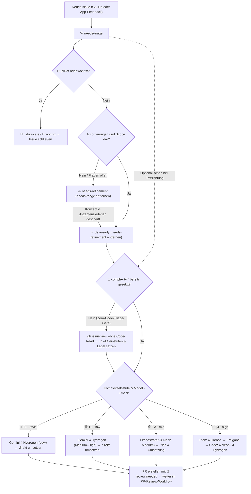

# Issue-Workflow: Triage, Refinement & Komplexitätsanalyse

Dieses Dokument beschreibt den Lebenszyklus von GitHub-Issues in `dmstern/reisotor` — von der Erfassung (`🔍️ needs-triage`) über fachliches Refinement (`⚠️ needs-refinement`) und Umsetzungsreife (`✅️ dev-ready`) bis zur Komplexitätsanalyse (`🚦️ complexity:*`) und Übergabe in den [PR-Review-Workflow](./PR_REVIEW_GUIDE.md).

## 1. Beteiligte Labels

| Label                   | Bedeutung                                            | Wann gesetzt / entfernt?                                                                                 |
| :---------------------- | :--------------------------------------------------- | :------------------------------------------------------------------------------------------------------- |
| `🔍️ needs-triage`       | Neu eingegangen, noch ungesichtet                    | Standard bei App-Feedback (`githubIssue.ts`) oder neuen Roh-Issues; wird nach der Erstsichtung entfernt. |
| `⚠️ needs-refinement`   | Fachlich / technisch noch unklar                     | Scope, UX, Edge-Cases oder Akzeptanzkriterien müssen erst geschärft werden.                              |
| `✅️ dev-ready`          | Bereit zur Umsetzung                                 | Anforderungen sind klar und abgestimmt; ein Agent oder Entwickler kann direkt starten.                   |
| `🚦️ complexity:trivial` | `T1` · 1–2 Dateien (Typo, Copy, CSS-Fix)             | Setzt Modell-Setup: **Gemini 4 Hydrogen (`Low`)**.                                                       |
| `🚦️ complexity:low`     | `T2` · 2–5 Dateien, klares Muster                    | Setzt Modell-Setup: **Gemini 4 Hydrogen (`Medium`–`High`)**.                                             |
| `🚦️ complexity:mid`     | `T3` · Mehrere Schichten, Default                    | Setzt Modell-Setup: **Orchestrator (`Gemini 4 Neon Medium`)**.                                           |
| `🚦️ complexity:high`    | `T4` · Architektur, Migration, Auth, vage Root-Cause | Setzt 2-Phasen-Setup: **Plan `4 Carbon` → Code `4 Neon`/`4 Hydrogen`**.                                  |

## 2. Ablauf-Diagramm

## 3. Zusammenspiel der Phasen

- **`⚠️ needs-refinement` vs. `🚦️ complexity:*`:** `needs-refinement` beantwortet _„Wissen wir schon genau, WAS gebaut werden soll?“_, während `🚦️ complexity:*` beantwortet _„Wie komplex wird die Umsetzung und welches Modell braucht der Agent?“_. Ein unlares Issue kann bereits grob eingeschätzt sein (`T4` solange vage) oder erhält sein `🚦️ complexity:*`-Label spätestens beim Wechsel auf `✅️ dev-ready` bzw. im `/triage`-Gate.
- **Zero-Code-Triage-Gate vor dem Start:** Sobald ein Agent auf ein Issue angesetzt wird (mit oder ohne `✅️ dev-ready`), liest er **vorab keinen Code** (`.agent/skills/triage/SKILL.md`), prüft nur `gh issue view`, ergänzt ein fehlendes `🚦️ complexity:*`-Label und stoppt mit dem Triage-Kompass, falls ein Modellwechsel nötig ist.
- **Übergang zum PR:** Nach erfolgreicher Umsetzung legt der Agent automatisch einen Nicht-Draft-PR mit `👀️ review:needed` an; ab dort greift der Lebenszyklus aus [`PR_REVIEW_GUIDE.md`](./PR_REVIEW_GUIDE.md).
