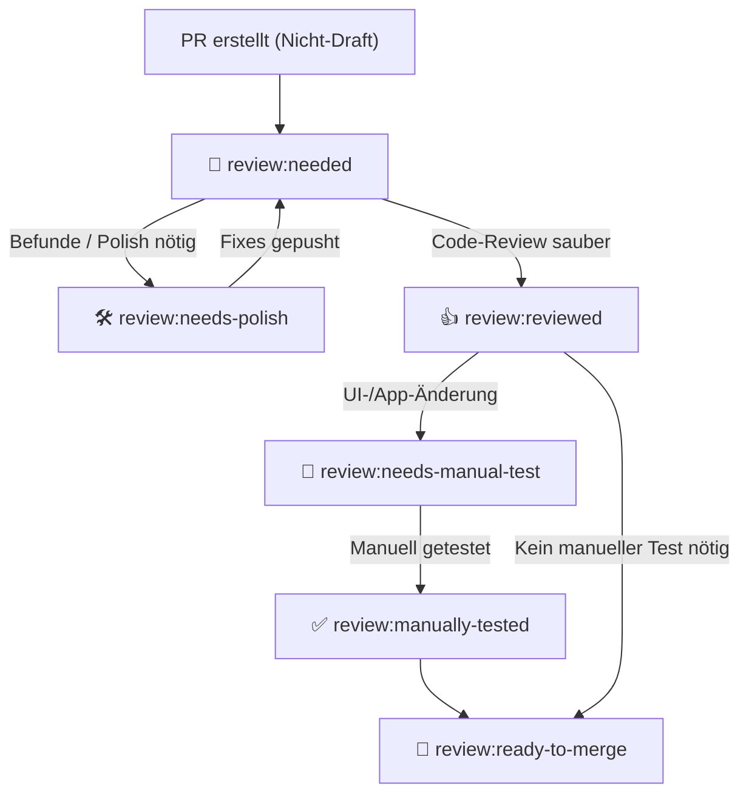

# PR-Review- & Label-System

Dieses Dokument beschreibt das systematische Code-Review- und Status-System für Pull Requests in `dmstern/reisotor`. Es sorgt bei mehreren parallelen PRs für einen klaren Überblick über vier Fragen:

1. **Ist das Code-Review schon erfolgt?** (`👀️ review:needed` / `🛠️ review:needs-polish` / `👍️ review:reviewed`)
2. **Muss noch manuell getestet werden oder ist das erledigt?** (`🧪️ review:needs-manual-test` / `✅️ review:manually-tested`)
3. **Haben wir darüber schon gesprochen?** (`💬️ review:discussed`)
4. **Kann der PR gemerged werden?** (`🚀️ review:ready-to-merge`)

## 1. Die GitHub-Labels (`review:*`)

### Code-Review-Stand (exklusiv: maximal 1 Label)

| Label                    | Bedeutung                    | Wann wird es gesetzt?                                                                               |
| :----------------------- | :--------------------------- | :-------------------------------------------------------------------------------------------------- |
| `👀️ review:needed`       | Wartet auf Code-Review       | Bei PR-Erstellung (Nicht-Draft) oder nach gepushten Fixes auf `needs-polish`.                       |
| `🛠️ review:needs-polish` | Fixes / Feinschliff nötig    | Code-Review hat Blocker, fehlende Tests/Checks oder Polish-Bedarf gefunden.                         |
| `👍️ review:reviewed`     | Code-Review erfolgt & sauber | Code-Review ist bestanden (bleibt sichtbar, auch wenn manueller Test oder Gespräch noch ausstehen). |

### Manueller Test (exklusiv untereinander; entfällt wenn Test n/a)

| Label                         | Bedeutung            | Wann wird es gesetzt?                                                                 |
| :---------------------------- | :------------------- | :------------------------------------------------------------------------------------ |
| `🧪️ review:needs-manual-test` | Manueller Test offen | Bei UI-/UX-/API-/Verhaltensänderungen, solange noch kein manueller Check erfolgt ist. |
| `✅️ review:manually-tested`   | Manuell getestet     | Sobald ein manueller/visueller Test im Browser erfolgreich durchgeführt wurde.        |

### Abstimmung & Merge-Freigabe

| Label                      | Bedeutung            | Wann wird es gesetzt?                                                                           |
| :------------------------- | :------------------- | :---------------------------------------------------------------------------------------------- |
| `💬️ review:discussed`      | Gemeinsam besprochen | Sobald Mensch und Agent/Team den PR-Stand besprochen und abgestimmt haben.                      |
| `🚀️ review:ready-to-merge` | Bereit zum Mergen    | Code-Review grün (`👍️`), kein Polish offen und manueller Test erledigt (`✅️`) oder nicht nötig. |

## 2. Typischer Lebenszyklus



- **`👍️ review:reviewed` vs. `🚀️ review:ready-to-merge`:** `👍️ review:reviewed` bedeutet ausdrücklich _„Code-Review sauber erfolgt“_ — nicht automatisch mergefertig, solange z. B. noch `🧪️ review:needs-manual-test` offen ist oder erst noch gesprochen werden soll.
- **`💬️ review:discussed`** kann zu jedem Zeitpunkt ergänzt werden, sobald ein Gespräch über den PR stattgefunden hat.
- **`✅️ review:manually-tested`** bleibt bei kleineren Polish-Fixes erhalten; nur nach größeren funktionalen Umbauten wird es bewusst wieder entfernt (`--manual-test needed`), damit erneut getestet wird.

## 3. Antigravity-Skill & CLI-Helfer

Der projektspezifische Antigravity-Skill liegt unter [`.agent/skills/pr-review/SKILL.md`](../.agent/skills/pr-review/SKILL.md) und wird automatisch erkannt.

Typische Aufrufe im Chat:

- **Systematisches Review durchführen:** _„Mach ein Code-Review für PR #901“_ (prüft Diff, Kriterien, setzt Labels und postet eine strukturierte Checkliste als PR-Kommentar).
- **Überblick über alle parallelen PRs:** _„Zeig mir das PR-Board“_ / _„Welche PRs muss ich noch testen?“_.
- **Schnelles Status-Update:** _„Setze PR #900 auf besprochen und manuell getestet“_.

Direkte CLI-Nutzung über das Hilfsskript [`.agent/skills/pr-review/scripts/pr-labels.mjs`](../.agent/skills/pr-review/scripts/pr-labels.mjs):

```bash
# Alle 7 review:*-Labels im Repository anlegen / abgleichen
node .agent/skills/pr-review/scripts/pr-labels.mjs sync

# Übersichtstabelle aller offenen PRs anzeigen
node .agent/skills/pr-review/scripts/pr-labels.mjs board

# Labels sauber aktualisieren (tauscht exklusive Gruppen automatisch)
node .agent/skills/pr-review/scripts/pr-labels.mjs set 901 --review reviewed --manual-test done --discussed true --ready true
```
