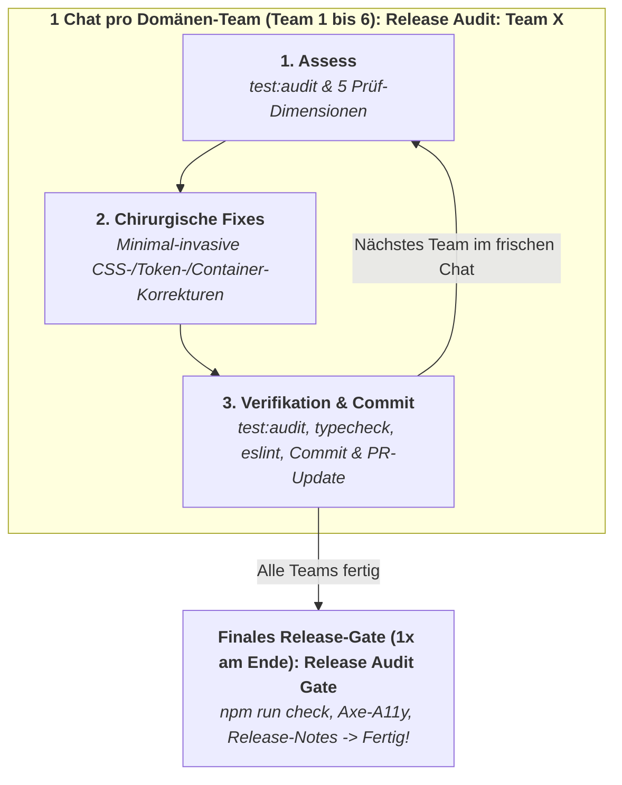
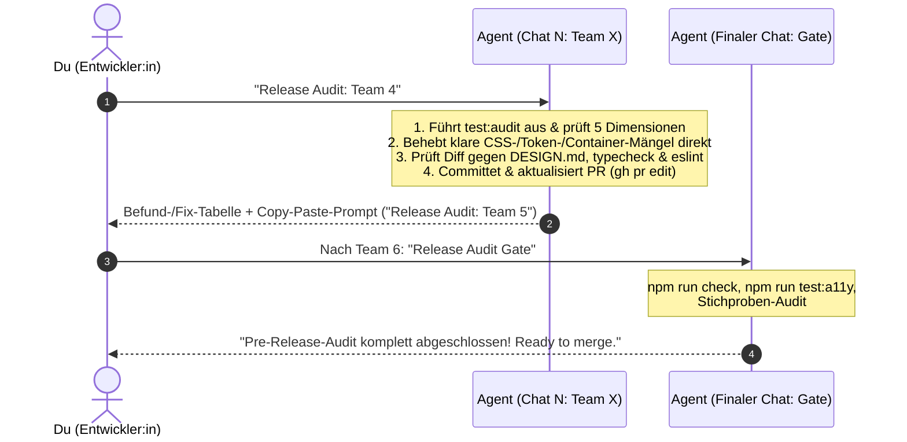

# UI-Audit-Guide

Dieses Dokument beschreibt das Vorgehen für UI-, Layout- und Container-Query-Audits in Reisotor sowie verbindliche Richtlinien für AI-Coding-Agenten (Antigravity / Claude Code) und Entwickler:innen.

> [!NOTE]
> **Vorgelagerte Code-Refactorings:** Für die strukturelle Überarbeitung überlanger oder historisch gewachsener Komponenten vor einem Layout-Audit siehe [`docs/AUDIT_PROMPTS.md`](AUDIT_PROMPTS.md) (SFC-Schichten-Modell: `<script>` → `<template>` → `<style>`). Dieser Leitfaden konzentriert sich auf die **visuelle Härtung, Enge-Resilienz und das automatisierte Layout-Testing**.

---

## 1. Die 3 goldenen Architektur-Regeln für Layouts in Reisotor

### Regel 1: Der Drawer-Effekt & Container-Queries (`@container app-main`)

In Reisotor existieren auf Desktop (≥ 1024px) stufenlos in der Breite verstellbare Seitenelemente:

- **Kalenderschublade (`Drawer.vue`):** stufenlos von **280px bis 860px** verstellbar (Standard: 360px).
- **Spots-Spalte (`.spots-col` in `ExcursionsView.vue`):** stufenlos von **280px bis 75cqw** verstellbar (Standard: 380px).

Wenn diese Elemente geöffnet und breit gezogen werden, schrumpft die Inhaltsbreite von `.app-main` bzw. der Kartenansicht selbst auf großen Monitoren drastisch (von 1280px auf bis zu 340px!).

- **Verbot von `@media` für Inhalts-Komponenten:** Komponenten innerhalb von `.app-main` dürfen Breiten-Entscheidungen nicht über `@media (min-width: ...)` treffen (da `window.innerWidth` unverändert groß bleibt), sondern müssen `@container app-main (min-width: ...)` oder flexibles Flexbox-Wrapping (`flex-wrap: wrap`) nutzen.
- **Stufenlos-Matrix:** Jede Ansicht muss Desktop-Engezustände bei maximal geöffneten Seitenelementen stabil aushalten.

### Regel 2: Die 3-Viewport-Matrix (`helpers/layout.ts`)

Layouts und interaktive Elemente müssen auf mindestens 3 repräsentativen Bildschirmgrößen verifiziert werden:

1. `narrowMobile`: **320x568px** (iPhone SE / kleine Androids – hier entstehen 80% aller Text-/Icon-Clashes und horizontalen Scrollbalken).
2. `mobile`: **390x844px** (Standard-Smartphone).
3. `desktop`: **1280x800px** (Standard-Desktop/Laptop) – immer mit geschlossener, normal geöffneter UND maximal breit gezogener Schublade (`setCalendarDrawerWidth(page, 500)`).
   _(Optional für Zwischentests: `narrowDesktop` mit 1080x900px an der Desktop-Schwelle)._

### Regel 3: Mathematische Layout-Defensiv-Checks statt visueller Blindheit

Klassische funktionale E2E-Tests (`expect(btn).toBeVisible()`) sind visuell blind: Ein Button gilt als sichtbar, selbst wenn er von einem Sticky Header verdeckt wird oder Text seitlich aus dem Bildschirm ausbricht.

- **Kein horizontaler Overflow:** In E2E-Tests immer `await expectNoHorizontalOverflow(page)` aus `helpers/layout.ts` aufrufen (`document.documentElement.scrollWidth <= window.innerWidth`). Kein Screen darf auf Mobile seitlich wackeln.
- **Touch-Targets einhalten:** Interaktive Elemente auf Mobile mit `expectMinTouchTarget(locator, 44)` auf mindestens 44x44px absichern.
- **Keine Element-Verdeckung:** Schwebende Menüs, Modals oder Aktions-Buttons auf Kollision mit Backdrops oder Headern mittels `expectNotCoveredBy(page, target, blocker)` prüfen.

---

## 2. Tooling & Infrastruktur im Repo

1. **`e2e/tests/helpers/layout.ts` (E2E-Helper)**:
   - `VIEWPORTS.narrowMobile` (320x568px), `mobile` (390x844px), `narrowDesktop` (1080x900px), `desktop` (1280x800px).
   - `expectNoHorizontalOverflow(page)`: Prüft mathematisch auf horizontalen Scrollbar-Overflow.
   - `expectMinTouchTarget(locator, minSize)`: Prüft Mindestgröße (44x44px) auf Mobile.
   - `expectNotCoveredBy(page, target, blocker)`: Prüft Sichtbarkeit per `elementFromPoint()`.
   - `setCalendarDrawerOpen(page, open)` / `setCalendarDrawerWidth(page, width)`: Steuert die Kalenderschublade.
   - `setSpotsColumnWidth(page, width)`: Verstellt die Spots-Spalte stufenlos.
   - `getAppMainContentWidth(page)`: Misst die tatsächliche gerenderte Breite von `.app-main`.

2. **Wiederverwendbare Playwright-Vorlage**:
   - Vorlage: `e2e/tests/scratch/audit-template.spec.ts`
   - **Standard-Befehl (Token-schonend ohne Screenshots):**
     ```bash
     AUDIT_ROUTE=<route> npm run test:audit
     ```
   - **Befehl mit Screenshots (nur auf explizite Nutzer-Aufforderung):**
     ```bash
     AUDIT_ROUTE=<route> AUDIT_SCREENSHOTS=true npm run test:audit
     ```

3. **Mikro-Ebene: Storybook Stress-Fixtures**:
   - `frontend/src/stories/stressFixtures.ts`: Standardisierte Stresstests (extrem langes deutsches Kompositum `STRESS_STRINGS.longWord`, Fließtext, Sonderzeichen und Begrenzungsrahmen `STRESS_CONTAINERS.narrow` / `ultraNarrow`).
   - Ermöglicht das visuelle Testen einzelner Komponenten im isolierten Zustand (`npm --prefix frontend run storybook`).

---

## 3. Lokaler Audit-Workflow (Einzelne View / Nach Refactoring)

Wird ausgeführt nach Änderungen an einer View, im Rahmen von Phase 3 eines Refactorings oder bei der Bearbeitung von UI-Layout-Bugs.

### Trigger-Phrasen für Agenten

- _„Mach ein UI-Audit zu dem Change von eben“_
- _„UI-Audit machen“_
- _„Layout-Audit für die Änderungen“_

### Autonomes Protokoll für den Agenten

1. **Route ermitteln:** Prüfe `git status` / `git diff` und ermittle die modifizierte Frontend-Komponente und die passende Route:
   - `SpotsView.vue` → `/trip/1/spots`
   - `ExcursionsView.vue` → `/trip/1/excursions`
   - `ScheduleView.vue` → `/trip/1/calendar` (sowie Desktop-Schublade `Drawer.vue`)
   - `PackingListView.vue` → `/trip/1/packing`
   - `ShoppingListView` (Tab) → `/trip/1/shopping`
   - `TodoView.vue` → `/trip/1/todo`
   - `NotesView.vue` → `/trip/1/notes`
   - `DiaryView.vue` → `/trip/1/diary`
   - `BudgetView.vue` → `/trip/1/budget`
   - `DashboardView.vue` → `/trip/1`
   - `TripsView.vue` → `/trips`
   - `SettingsView.vue` → `/settings`
   - `LoginView.vue` → `/login`
   - `SecurityCheckView.vue` → `/security-check`
   - `TrashView.vue` → `/trip/1/trash`
2. **Audit ausführen:** Führe `AUDIT_ROUTE=<route> npm run test:audit` aus (standardmäßig **ohne** `AUDIT_SCREENSHOTS=true`).
3. **Ergebnis bewerten:**
   - Wurden horizontale Overflows oder Berührungsziel-Verletzungen gefunden?
   - Treten Kollisionen bei stufenlos geöffneter Schublade auf Desktop auf?
4. **Defensiv beheben:** Behebe Layout-Kollisionen ausschließlich unter strikter Einhaltung von [`DESIGN.md`](../DESIGN.md) (Design-Tokens `--space-*`, `--color-*`, Container-Queries `@container app-main`, Flexbox-Wrapping). Keine ad-hoc Inline-Styles oder magische Pixelabstände!
5. **Screenshots nur auf Abruf:** Screenshots werden **niemals unaufgefordert** erstellt. Nur wenn die Nutzerin / der Nutzer explizit Screenshots verlangt, führe den Befehl mit `AUDIT_SCREENSHOTS=true` aus und verlinke die Bilder per Markdown im Walkthrough (niemals per `view_file` selbst öffnen).

---

## 4. Pre-Release-Stabilitäts-Gate (Ganzheitliches Release-Audit)

Vor großen Releases (z. B. neuen Minor- oder Major-Versionen) erfolgt die ganzheitliche Prüfung aller Bereiche der App.

### Leitphilosophie: Stabilisierung & Polishing statt blinder Groß-Refactorings!

Bis kurz vor einem Release werden oft noch Bugs behoben, neue Funktionen fertiggestellt und UI-Verbesserungen integriert. Dabei entstehen typische Last-Minute-Mängel:

- Abgeschnittene Popovers, Dropdowns oder Tooltips (`overflow: hidden` auf Elternelementen oder falscher Z-Index).
- Schlechte Umbrüche auf schmalen Viewports (320px/390px): Zahlenwerte, Währungen oder Datum-Badges brechen unleserlich um; es fehlt `min-width: 0` oder `overflow-wrap: break-word`.
- Fehlende oder inkonsistente `:hover`- und `:focus-visible`-Zustände.
- Abweichende Paddings und Abstände, die aus der Token-Skala (`--space-*`) herausfallen.
- Zu kleine, unleserliche Labels oder Icons.

> [!CAUTION]
> **Strikte Trennung von Inspektion & Behebung – Kein blindes Umbauen!**
> Ein Pre-Release-Audit darf **niemals als pauschaler „Such-und-Reparier-alles-auf-einmal“-Auftrag** an AI-Agenten gegeben werden!
> Solche Aufträge führen verlässlich zu drei Fehlern:
>
> 1. **Sycophancy („Nach dem Mund reden“):** Der Agent klickt oberflächlich durch und meldet „Alles perfekt“, übersieht aber abgeschnittene Modals oder wackelnde Mobile-Layouts.
> 2. **Aktionismus (Zerstörer-Refactoring):** Der Agent baut funktionierende Komponenten oder CSS-Grids eigenmächtig um und erzeugt kurz vor Release neue, schwere Regressionen.
> 3. **Kontext-Kollaps:** Das gleichzeitige Prüfen von 14 Routen und Bearbeiten von Dateien sprengt das Kontextfenster.
>
> **Verbindliche Regel:** Vor einem Release finden **KEINE Architektur-Refactorings** statt. Das Pre-Release-Gate dient ausschließlich der **visuellen Härtung, Konsistenz und chirurgischen Fehlerbehebung**.

---

### Das Modell des Release-Gates („1 Team = 1 Chat“ + Finales Gate)

> [!NOTE]
> **1 Branch & 1 PR für alle Teams – 1 kompakter Chat pro Team!**
> Alle Teams (1 bis 6) arbeiten nacheinander auf **einem gemeinsamen Feature-Branch** (z. B. `perform_prerelease_audit`) und in **einem einzigen zentralen PR**. Um Token-Kontingent und Copy-Paste-Aufwand zu sparen, gleichzeitig aber das Kontextfenster pro Domäne frisch zu halten, wird **jedes Team in genau einem Chat (`Release Audit: Team X`)** komplett abgearbeitet (Inspektion → Chirurgische CSS-/Token-Fixes → Verifikation & Eigen-Review → Commit & PR-Update). Erst wenn alle 6 Teams durch sind, folgt einmalig **`Release Audit Gate`** für den technischen Gesamt-Abschluss (`npm run check`, `test:a11y`).



### Interaktions-Ablauf in der Praxis (Mensch & Agent)

Folgendes Sequenzdiagramm veranschaulicht den schlanken Ablauf pro Team:



#### So läuft ein Team-Durchlauf ab:

1. **Ein Trigger pro Team (`Release Audit: Team X`):**
   - Der Agent prüft die Routen und Komponenten des Teams, behebt alle eindeutigen, risikoarmen CSS-/Token-/Container-Query-Mängel direkt selbst, sichert das Ergebnis mit `test:audit`, `typecheck` und `eslint` ab, committet sauber und aktualisiert die PR-Beschreibung (`gh pr edit`).
   - **Sicherheitsschranke:** Falls ein Befund einen tieferen Eingriff in die Komponenten-Struktur erfordern würde, baut der Agent ihn **nicht** eigenmächtig um, sondern markiert ihn in der Abschluss-Tabelle als _„Übersprungen (Rückfrage/Nach-Release)“_.
   - Am Ende gibt der Agent eine kompakte **Befund- & Fix-Tabelle** zur Information aus sowie den **kopierbaren Einzeiler für das nächste Team (`Release Audit: Team <X+1>`)**.
2. **Einmaliger Abschluss (`Release Audit Gate`):**
   - Wenn alle Teams durchlaufen sind, prüft `Release Audit Gate` einmalig die projektweiten Schranken (`npm run check`, `npm run test:a11y`) und meldet den Gesamtabschluss des Audits.

---

### Die 6 Fachdomänen

Um das Kontextfenster zu schonen, wird die Anwendung in 6 klar abgegrenzte Domänen aufgeteilt:

- **Team 1 (Dashboard, Navigation & Trips):** `/trip/1`, `/trips` (Header, Navbar, Widgets, Reise-Wechsel)
- **Team 2 (Spots, Touren & Karten):** `/trip/1/spots`, `/trip/1/excursions` (MapLibre-Karte, Split-View, stufenlose Spots-Spalte, Bottom-Sheets)
- **Team 3 (Kalender & Zeitplan):** `/trip/1/calendar`, Desktop-Kalenderschublade `Drawer.vue` (Tages-/Wochenansicht, Drag-Handles, Termin-Modals, Export)
- **Team 4 (Listen, Notizen & Content):** `/trip/1/packing`, `/trip/1/shopping`, `/trip/1/todo`, `/trip/1/notes`, `/trip/1/diary` (Tabs in `ListenView`, Notizen-Grid & Rich-Text, Tagebuch-Timeline)
- **Team 5 (Finanzen & Budget):** `/trip/1/budget` (Budget-Töpfe, Transaktionslisten, Währungsumrechnung, Ausgleichs-Karten, Modals; Enge-Stresstest auf 320px)
- **Team 6 (Einstellungen, Auth & Hilfsansichten):** `/settings` (7 Tabs: Account, Users, App/Wetter, Trip, Notifications, Data, About), `/login`, `/security-check`, `/trip/1/trash`

---

### Die 5 Prüf-Dimensionen pro Domäne

Jeder Prüfdurchlauf analysiert systematisch folgende fünf Kriterien:

1. **Enge- & Overflow-Matrix (320x568px narrowMobile & 390x844px mobile):**
   - Gibt es horizontalen Scroll-Overflow (`expectNoHorizontalOverflow`)?
   - Brechen Zahlenwerte, Währungen oder Datum-Badges unschön um?
   - Fehlt bei Flex-Kindern `min-width: 0` oder `overflow-wrap: break-word`?
2. **Overlay-, Popover- & Modal-Matrix:**
   - Öffnen sich alle Dropdowns, Kontext-Menüs, Popovers und Filter-Sheets vollständig?
   - Werden Menüs durch `overflow: hidden` auf umliegenden Containern abgeschnitten?
   - Stimmen Z-Indizes gegenüber Sticky-Headern und Kartenelementen?
3. **Interaktionen, Hover- & Focus-States:**
   - Besitzen interaktive Kacheln, Buttons und Zeilen sichtbare, ruhige `:hover`- und `:focus-visible`-Zustände?
   - Werden Touch-Targets von mindestens 44x44px auf Mobile eingehalten (`expectMinTouchTarget`)?
4. **Visuelle Konsistenz & Design-Tokens:**
   - Halten alle Abstände die Token-Skala (`--space-xs` bis `--space-2xl`) ein?
   - Sind Sekundär- und Badge-Labels lesbar (nicht unter 11-12px) und semantisch gefärbt?
   - Werden für Badges/Pillen niemals `border-radius: 50%`, sondern `--radius-pill` verwendet?
5. **Desktop-Drawer-Stresstest (1280x800px mit Kalenderschublade auf 500px+):**
   - Hält der Inhaltsbereich die reduzierte Breite stabil aus?
   - Springen Elemente oder bricht das Layout unruhig um?

---

### Einstiegs-Phrasen & Verhalten bei allgemeiner Aufforderung

Fällt im Chat eine allgemeine Aufforderung wie:

- _„Mach ein Pre-Release-Audit“_
- _„Pre-Release Audit starten“_
- _„Wir bereiten ein Release vor, auditier mal die App“_

**Striktes Protokoll für den Agenten:**

1. **Kein blinder Komplettdurchlauf:** Der Agent darf **niemals unaufgefordert alle 6 Teams auf einmal** in einer Session abfeuern (Gefahr von Kontext-Kollaps und Sycophancy).
2. **Git-Delta ermitteln:** Er ermittelt per Git, welche Frontend-Bereiche seit dem letzten Release-Tag tatsächlich verändert wurden:
   `git log $(git describe --tags --abbrev=0 --match "v*" 2>/dev/null || echo "v1.0.0")..HEAD --name-only frontend/`
3. **Fokussierte Empfehlung & Roadmap:** Er ordnet die Änderungen den betroffenen Teams zu (z. B. _„Seit v1.3.0 wurden vor allem Finanzen (Team 5) und Notizen/Listen (Team 4) verändert“_) und schlägt vor:
   - **Gezielter Check (Empfohlen):** Nur die veränderten Teams durchlaufen (spart massiv Tokens und Zeit).
   - **Vollständiger Meilenstein-Check:** Schrittweise von Team 1 bis 6.
4. **Sofortige Führung:** Der Agent schlägt direkt den ersten konkreten Schritt vor oder startet auf Bestätigung mit dem ersten Team (`Release Audit: Team <X>`).

---

### Kurz-Trigger für das Release-Gate

| Schritt                   | Kurz-Trigger                             | Beschreibung                                                                                                                                                                                                          |
| :------------------------ | :--------------------------------------- | :-------------------------------------------------------------------------------------------------------------------------------------------------------------------------------------------------------------------- |
| **Pro Team** _(1 Chat)_   | `Release Audit: <Team \| Route>`         | **All-in-One pro Team (Standard):** Prüft die 5 Dimensionen + `test:audit`, behebt klare CSS-/Token-/Container-Mängel direkt, prüft `typecheck` & `eslint`, committet, updated PR & gibt Nächster-Schritt-Prompt aus. |
| **Abschluss** _(1x Ende)_ | `Release Audit Gate`                     | **Finales Gesamt-Gate:** Führt nach Abschluss aller Teams einmalig `npm run check`, A11y- (Axe) und Release-Notes-Prüfungen für die Merge-Freigabe aus.                                                               |
| _(Optional einzeln)_      | `Release Audit Assess / Fix / Review: …` | Optionale Einzel-Trigger, falls ausnahmsweise nur eine Read-Only-Inspektion (`Assess`), ein gezielter Fix (`Fix`) oder ein isoliertes Nach-Review (`Review`) gewünscht ist.                                           |

---

### Standard-Durchlauf pro Team (`Release Audit: <Team | Route>`)

Kopiere diesen Kurz-Trigger in einen frischen Chat, um ein komplettes Team in einem Zug prüfen, polieren und abnehmen zu lassen:

````text
Release Audit: [Team 1-6 oder Route, z. B. Team 4]

Führe das komplette Release-Audit (Inspektion -> Chirurgische Fixes -> Verifikation & Eigen-Review -> Commit & PR-Update) für den angegebenen Bereich in einem Durchlauf durch.

STRIKTE LEITPLANKEN:
- Keine Architektur-Refactorings: Keine neuen Props/Emits, keine Store-Umbauten, keine Komponenten-Zerlegung!
- Ausschließlich risikoarme, zielgerichtete CSS-/Template-/Token-Korrekturen:
  * Design-Tokens (--space-*, --color-*, --radius-pill statt 50% oder magischer Pixel)
  * Container-Queries (@container app-main statt @media für Komponenten innerhalb von .app-main)
  * Enge-Resilienz (min-width: 0, flex-wrap: wrap, overflow-wrap: break-word, white-space: nowrap für Badges/Beträge)
  * Overlays & Popovers (z-index, kein Abschneiden durch overflow: hidden)
  * Interaktionen (:hover, :focus-visible Ringe via --color-focus-ring, Touch-Targets >= 44px)
- Sicherheitsschranke: Falls ein Befund einen tieferen strukturellen Umbau erfordern würde, führe ihn NICHT eigenmächtig durch, sondern vermerke ihn in der Tabelle als "⏭️ Übersprungen (Nach-Release)".

Vorgehensweise:
1. E2E-Layout-Audit ausführen (bei Multi-Routen-Teams komma-separiert):
   AUDIT_ROUTE=<route1,route2> npm run test:audit
2. Quellcode der relevanten Vue-Komponenten systematisch auf die 5 Prüf-Dimensionen untersuchen.
3. Gefundene Blocker (🔴) und klare Polish-Punkte (🟡) direkt minimal-invasiv im Code beheben.
4. Verifikation & Eigen-Review gegen DESIGN.md:
   - Falls Code geändert wurde: Erneut `AUDIT_ROUTE=<route1,route2> npm run test:audit` ausführen.
   - `npm run typecheck` und `npx -y eslint <geänderte-dateien>` prüfen.
   - Formatieren (`npx -y prettier --write <geänderte-dateien>`) und sauber committen (`git commit -m "fix(ui): polish <domäne> layout & token resilience"`).
5. PR-Beschreibung aktualisieren:
   Aktualisiere den zentralen PR via `gh pr edit`, sodass die erledigten Fixes und der Abschluss dieses Teams dokumentiert sind.

Ergebnis & Pflicht-Handoff im Chat:
1. Gib eine kompakte Übersichtstabelle aus, damit auf einen Blick klar ist, was geprüft und gemacht wurde:

| Status | Route / Komponente | Viewport / Zustand | Befund | Durchgeführte Maßnahme |
| :--- | :--- | :--- | :--- | :--- |
| 🛠️ Behoben (🔴/🟡) | `/trip/1/budget` | 320px | Betrag bricht um | `white-space: nowrap` ergänzt |
| 🟢 OK | `/trip/1/notes` | 1280px (500px Drawer) | Grid bricht sauber via `@container` um | Kein Handlungsbedarf |

2. VORBEREITETER HANDOFF-PROMPT FÜR DEN NÄCHSTEN SCHRITT (Pflicht):
   Gib am Ende IMMER zwingend den nächsten Schritt prominent als kopierbaren Code-Block für einen frischen Chat aus:
   * Wenn weitere Teams ausstehen (z. B. nach Team 4 kommt Team 5):
     👉 Nächster Schritt (In einem frischen Chat für das nächste Team ausführen):
     ```text
     Release Audit: Team [N+1]
     ```
   * Wenn alle Teams (1 bis 6) komplett durchlaufen sind:
     👉 Nächster Schritt (In einem frischen Chat für das finale Gesamt-Gate ausführen):
     ```text
     Release Audit Gate
     ```
````

---

### Finales Release-Gate (`Release Audit Gate`)

Führt **einmalig ganz am Ende** (nachdem alle Teams abgeschlossen sind) die finale technische Qualitätssicherung vor dem Merge/Tagging durch:

```text
Release Audit Gate

Führe das finale Release-Gate durch, um die Gesamtstabilität des Branches nach Abschluss aller Teams zu zertifizieren.

Prüfschritte:
1. Statisches Gesamt-Gate (Lint, Format, Release-Notes, Typecheck Frontend & Backend): npm run check
2. Barrierefreiheit (Axe): npm run test:a11y
3. Layout-Regressionen Stichprobe: AUDIT_ROUTE=/trip/1 npm run test:audit

Ergebnis:
Gib eine klare Bestätigung im Chat aus:
- Sind alle automatisierten Prüfungen grün?
- Gibt es verbleibende Warnungen oder offene Punkte?
- Ist das Release freigegeben?
- Falls alle Prüfungen erfolgreich sind: Gib explizit die Bestätigung aus, dass das Pre-Release-Audit für alle Teams vollständig abgeschlossen ist und der PR gemergt werden kann.
```
