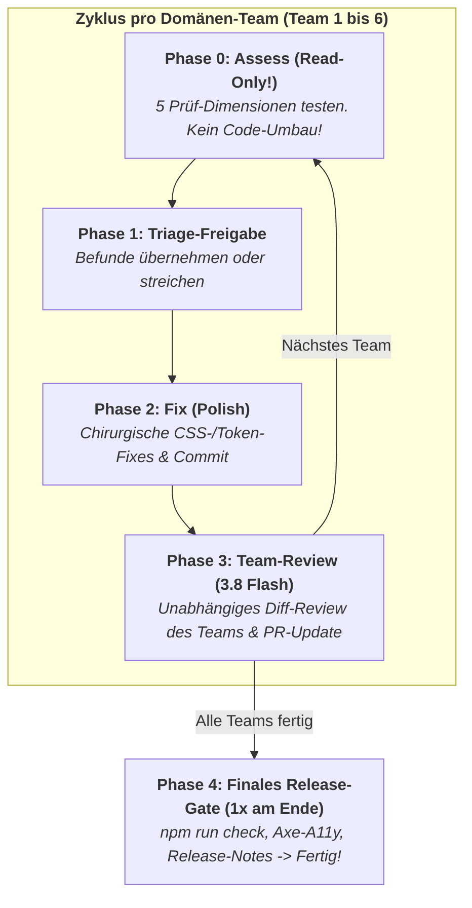
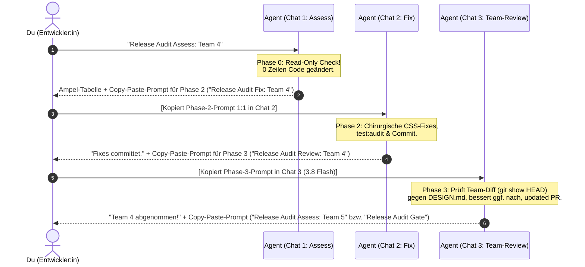

# UI-Audit-Guide

Dieses Dokument beschreibt das Vorgehen für UI-, Layout- und Container-Query-Audits in Reisotor sowie verbindliche Richtlinien für AI-Coding-Agenten (Antigravity / Claude Code) und Entwickler:innen.

> [!NOTE]
> **Vorgelagerte Code-Refactorings:** Für die strukturelle Überarbeitung überlanger oder historisch gewachsener Komponenten vor einem Layout-Audit siehe [`docs/AUDIT_PROMPTS.md`](AUDIT_PROMPTS.md) (SFC-Schichten-Modell: `<script>` → `<template>` → `<style>`). Dieser Leitfaden konzentriert sich auf die **visuelle Härtung, Enge-Resilienz und das automatisierte Layout-Testing**.

---

## 1. Die 3 goldenen Architektur-Regeln für Layouts in Reisotor

### Regel 1: Der Drawer-Effekt & Container-Queries (`@container app-main`)

In Reisotor existieren auf Desktop (≥ 1024px) stufenlos in der Breite verstellbare Seitenelemente:

- **Kalenderschublade (`Drawer.vue`):** stufenlos von **280px bis 860px** verstellbar (Standard: 360px).
- **Spots-Spalte (`.spots-col` in `ExcursionsView.vue`):** stufenlos von **280px bis 75cqw** verstellbar (Standard: 380px).

Wenn diese Elemente geöffnet und breit gezogen werden, schrumpft die Inhaltsbreite von `.app-main` bzw. der Kartenansicht selbst auf großen Monitoren drastisch (von 1280px auf bis zu 340px!).

- **Verbot von `@media` für Inhalts-Komponenten:** Komponenten innerhalb von `.app-main` dürfen Breiten-Entscheidungen nicht über `@media (min-width: ...)` treffen (da `window.innerWidth` unverändert groß bleibt), sondern müssen `@container app-main (min-width: ...)` oder flexibles Flexbox-Wrapping (`flex-wrap: wrap`) nutzen.
- **Stufenlos-Matrix:** Jede Ansicht muss Desktop-Engezustände bei maximal geöffneten Seitenelementen stabil aushalten.

### Regel 2: Die 3-Viewport-Matrix (`helpers/layout.ts`)

Layouts und interaktive Elemente müssen auf mindestens 3 repräsentativen Bildschirmgrößen verifiziert werden:

1. `narrowMobile`: **320x568px** (iPhone SE / kleine Androids – hier entstehen 80% aller Text-/Icon-Clashes und horizontalen Scrollbalken).
2. `mobile`: **390x844px** (Standard-Smartphone).
3. `desktop`: **1280x800px** (Standard-Desktop/Laptop) – immer mit geschlossener, normal geöffneter UND maximal breit gezogener Schublade (`setCalendarDrawerWidth(page, 500)`).
   _(Optional für Zwischentests: `narrowDesktop` mit 1080x900px an der Desktop-Schwelle)._

### Regel 3: Mathematische Layout-Defensiv-Checks statt visueller Blindheit

Klassische funktionale E2E-Tests (`expect(btn).toBeVisible()`) sind visuell blind: Ein Button gilt als sichtbar, selbst wenn er von einem Sticky Header verdeckt wird oder Text seitlich aus dem Bildschirm ausbricht.

- **Kein horizontaler Overflow:** In E2E-Tests immer `await expectNoHorizontalOverflow(page)` aus `helpers/layout.ts` aufrufen (`document.documentElement.scrollWidth <= window.innerWidth`). Kein Screen darf auf Mobile seitlich wackeln.
- **Touch-Targets einhalten:** Interaktive Elemente auf Mobile mit `expectMinTouchTarget(locator, 44)` auf mindestens 44x44px absichern.
- **Keine Element-Verdeckung:** Schwebende Menüs, Modals oder Aktions-Buttons auf Kollision mit Backdrops oder Headern mittels `expectNotCoveredBy(page, target, blocker)` prüfen.

---

## 2. Tooling & Infrastruktur im Repo

1. **`e2e/tests/helpers/layout.ts` (E2E-Helper)**:
   - `VIEWPORTS.narrowMobile` (320x568px), `mobile` (390x844px), `narrowDesktop` (1080x900px), `desktop` (1280x800px).
   - `expectNoHorizontalOverflow(page)`: Prüft mathematisch auf horizontalen Scrollbar-Overflow.
   - `expectMinTouchTarget(locator, minSize)`: Prüft Mindestgröße (44x44px) auf Mobile.
   - `expectNotCoveredBy(page, target, blocker)`: Prüft Sichtbarkeit per `elementFromPoint()`.
   - `setCalendarDrawerOpen(page, open)` / `setCalendarDrawerWidth(page, width)`: Steuert die Kalenderschublade.
   - `setSpotsColumnWidth(page, width)`: Verstellt die Spots-Spalte stufenlos.
   - `getAppMainContentWidth(page)`: Misst die tatsächliche gerenderte Breite von `.app-main`.

2. **Wiederverwendbare Playwright-Vorlage**:
   - Vorlage: `e2e/tests/scratch/audit-template.spec.ts`
   - **Standard-Befehl (Token-schonend ohne Screenshots):**
     ```bash
     AUDIT_ROUTE=<route> npm run test:audit
     ```
   - **Befehl mit Screenshots (nur auf explizite Nutzer-Aufforderung):**
     ```bash
     AUDIT_ROUTE=<route> AUDIT_SCREENSHOTS=true npm run test:audit
     ```

3. **Mikro-Ebene: Storybook Stress-Fixtures**:
   - `frontend/src/stories/stressFixtures.ts`: Standardisierte Stresstests (extrem langes deutsches Kompositum `STRESS_STRINGS.longWord`, Fließtext, Sonderzeichen und Begrenzungsrahmen `STRESS_CONTAINERS.narrow` / `ultraNarrow`).
   - Ermöglicht das visuelle Testen einzelner Komponenten im isolierten Zustand (`npm --prefix frontend run storybook`).

---

## 3. Lokaler Audit-Workflow (Einzelne View / Nach Refactoring)

Wird ausgeführt nach Änderungen an einer View, im Rahmen von Phase 3 eines Refactorings oder bei der Bearbeitung von UI-Layout-Bugs.

### Trigger-Phrasen für Agenten

- _„Mach ein UI-Audit zu dem Change von eben“_
- _„UI-Audit machen“_
- _„Layout-Audit für die Änderungen“_

### Autonomes Protokoll für den Agenten

1. **Route ermitteln:** Prüfe `git status` / `git diff` und ermittle die modifizierte Frontend-Komponente und die passende Route:
   - `SpotsView.vue` → `/trip/1/spots`
   - `ExcursionsView.vue` → `/trip/1/excursions`
   - `ScheduleView.vue` → `/trip/1/calendar` (sowie Desktop-Schublade `Drawer.vue`)
   - `PackingListView.vue` → `/trip/1/packing`
   - `ShoppingListView` (Tab) → `/trip/1/shopping`
   - `TodoView.vue` → `/trip/1/todo`
   - `NotesView.vue` → `/trip/1/notes`
   - `DiaryView.vue` → `/trip/1/diary`
   - `BudgetView.vue` → `/trip/1/budget`
   - `DashboardView.vue` → `/trip/1`
   - `TripsView.vue` → `/trips`
   - `SettingsView.vue` → `/settings`
   - `LoginView.vue` → `/login`
   - `SecurityCheckView.vue` → `/security-check`
   - `TrashView.vue` → `/trip/1/trash`
2. **Audit ausführen:** Führe `AUDIT_ROUTE=<route> npm run test:audit` aus (standardmäßig **ohne** `AUDIT_SCREENSHOTS=true`).
3. **Ergebnis bewerten:**
   - Wurden horizontale Overflows oder Berührungsziel-Verletzungen gefunden?
   - Treten Kollisionen bei stufenlos geöffneter Schublade auf Desktop auf?
4. **Defensiv beheben:** Behebe Layout-Kollisionen ausschließlich unter strikter Einhaltung von [`DESIGN.md`](../DESIGN.md) (Design-Tokens `--space-*`, `--color-*`, Container-Queries `@container app-main`, Flexbox-Wrapping). Keine ad-hoc Inline-Styles oder magische Pixelabstände!
5. **Screenshots nur auf Abruf:** Screenshots werden **niemals unaufgefordert** erstellt. Nur wenn die Nutzerin / der Nutzer explizit Screenshots verlangt, führe den Befehl mit `AUDIT_SCREENSHOTS=true` aus und verlinke die Bilder per Markdown im Walkthrough (niemals per `view_file` selbst öffnen).

---

## 4. Pre-Release-Stabilitäts-Gate (Ganzheitliches Release-Audit)

Vor großen Releases (z. B. neuen Minor- oder Major-Versionen) erfolgt die ganzheitliche Prüfung aller Bereiche der App.

### Leitphilosophie: Stabilisierung & Polishing statt blinder Groß-Refactorings!

Bis kurz vor einem Release werden oft noch Bugs behoben, neue Funktionen fertiggestellt und UI-Verbesserungen integriert. Dabei entstehen typische Last-Minute-Mängel:

- Abgeschnittene Popovers, Dropdowns oder Tooltips (`overflow: hidden` auf Elternelementen oder falscher Z-Index).
- Schlechte Umbrüche auf schmalen Viewports (320px/390px): Zahlenwerte, Währungen oder Datum-Badges brechen unleserlich um; es fehlt `min-width: 0` oder `overflow-wrap: break-word`.
- Fehlende oder inkonsistente `:hover`- und `:focus-visible`-Zustände.
- Abweichende Paddings und Abstände, die aus der Token-Skala (`--space-*`) herausfallen.
- Zu kleine, unleserliche Labels oder Icons.

> [!CAUTION]
> **Strikte Trennung von Inspektion & Behebung – Kein blindes Umbauen!**
> Ein Pre-Release-Audit darf **niemals als pauschaler „Such-und-Reparier-alles-auf-einmal“-Auftrag** an AI-Agenten gegeben werden!
> Solche Aufträge führen verlässlich zu drei Fehlern:
>
> 1. **Sycophancy („Nach dem Mund reden“):** Der Agent klickt oberflächlich durch und meldet „Alles perfekt“, übersieht aber abgeschnittene Modals oder wackelnde Mobile-Layouts.
> 2. **Aktionismus (Zerstörer-Refactoring):** Der Agent baut funktionierende Komponenten oder CSS-Grids eigenmächtig um und erzeugt kurz vor Release neue, schwere Regressionen.
> 3. **Kontext-Kollaps:** Das gleichzeitige Prüfen von 14 Routen und Bearbeiten von Dateien sprengt das Kontextfenster.
>
> **Verbindliche Regel:** Vor einem Release finden **KEINE Architektur-Refactorings** statt. Das Pre-Release-Gate dient ausschließlich der **visuellen Härtung, Konsistenz und chirurgischen Fehlerbehebung**.

---

### Das Phasen-Modell des Release-Gates (Pro Team + Finales Gate)

> [!NOTE]
> **1 Branch & 1 PR für alle Teams, aber Review pro Team!**
> Alle Teams (1 bis 6) arbeiten nacheinander auf **einem gemeinsamen Feature-Branch** (z. B. `perform_prerelease_audit`) und in **einem einzigen zentralen PR**. Damit das Kontextfenster klein bleibt und Fehler sofort behoben werden, durchläuft **jedes Team einzeln** die Phasen 0 bis 3 (Assess → Triage → Fix → **Team-Review mit 3.8 Flash**). Erst wenn alle 6 Teams komplett durch sind, folgt einmalig **Phase 4 (`Release Audit Gate`)** für den technischen Gesamt-Abschluss (`npm run check`, `test:a11y`).



### Interaktions-Ablauf in der Praxis (Mensch & Agent)

Folgendes Sequenzdiagramm veranschaulicht das Zusammenspiel zwischen Entwickler:in und Agenten pro Team:



#### Wann du reviewen lässt und wann du einen neuen Chat öffnest:

1. **Nach Phase 0 (`Release Audit Assess: Team X`):**
   - Der Agent liefert die Ampel-Befundtabelle (🔴 Blocker, 🟡 Polish, 🟢 OK) und generiert **am Ende automatisch den fertigen, kopierbaren Prompt-Block für Phase 2 (`Release Audit Fix: Team X`)**.
   - **Standardfall (Alles freigeben):** Du kopierst den Code-Block 1:1 in ein frisches Chat-Fenster.
   - **Auswahl anpassen:** Falls du einzelne Polish-Punkte ausschließen möchtest, löschst du vor dem Absenden einfach die entsprechenden Zeilen.
2. **Nach Phase 2 (`Release Audit Fix: Team X`):**
   - Der Fix-Agent setzt die Punkte um, führt `npm run test:audit` aus, committet und gibt **am Ende zwingend den kopierbaren Prompt für Phase 3 (`Release Audit Review: Team X`)** aus.
3. **In Phase 3 (`Release Audit Review: Team X` – Unabhängiges Team-Review mit 3.8 Flash):**
   - Ein frischer Agent prüft unvoreingenommen nur das kleine Diff dieses einen Teams (`git show HEAD`), kontrolliert Design-Tokens, `@container`-Queries und mögliche Seiteneffekte, bessert bei Bedarf sofort nach, aktualisiert den PR (`gh pr edit`) und gibt **am Ende zwingend den Prompt für das nächste Team (`Release Audit Assess: Team <X+1>`)** aus (oder nach Team 6 `Release Audit Gate`).
4. **Einmaliger Abschluss mit Phase 4 (`Release Audit Gate`):**
   - Wenn alle Teams durch Phase 3 abgenommen sind, prüft `Release Audit Gate` einmalig die projektweiten Schranken (`npm run check`, `npm run test:a11y`) und meldet den Gesamtabschluss des Audits.

---

### Die 6 Fachdomänen

Um das Kontextfenster zu schonen, wird die Anwendung in 6 klar abgegrenzte Domänen aufgeteilt:

- **Team 1 (Dashboard, Navigation & Trips):** `/trip/1`, `/trips` (Header, Navbar, Widgets, Reise-Wechsel)
- **Team 2 (Spots, Touren & Karten):** `/trip/1/spots`, `/trip/1/excursions` (MapLibre-Karte, Split-View, stufenlose Spots-Spalte, Bottom-Sheets)
- **Team 3 (Kalender & Zeitplan):** `/trip/1/calendar`, Desktop-Kalenderschublade `Drawer.vue` (Tages-/Wochenansicht, Drag-Handles, Termin-Modals, Export)
- **Team 4 (Listen, Notizen & Content):** `/trip/1/packing`, `/trip/1/shopping`, `/trip/1/todo`, `/trip/1/notes`, `/trip/1/diary` (Tabs in `ListenView`, Notizen-Grid & Rich-Text, Tagebuch-Timeline)
- **Team 5 (Finanzen & Budget):** `/trip/1/budget` (Budget-Töpfe, Transaktionslisten, Währungsumrechnung, Ausgleichs-Karten, Modals; Enge-Stresstest auf 320px)
- **Team 6 (Einstellungen, Auth & Hilfsansichten):** `/settings` (7 Tabs: Account, Users, App/Wetter, Trip, Notifications, Data, About), `/login`, `/security-check`, `/trip/1/trash`

---

### Die 5 Prüf-Dimensionen pro Domäne

Jeder Prüfdurchlauf analysiert systematisch folgende fünf Kriterien:

1. **Enge- & Overflow-Matrix (320x568px narrowMobile & 390x844px mobile):**
   - Gibt es horizontalen Scroll-Overflow (`expectNoHorizontalOverflow`)?
   - Brechen Zahlenwerte, Währungen oder Datum-Badges unschön um?
   - Fehlt bei Flex-Kindern `min-width: 0` oder `overflow-wrap: break-word`?
2. **Overlay-, Popover- & Modal-Matrix:**
   - Öffnen sich alle Dropdowns, Kontext-Menüs, Popovers und Filter-Sheets vollständig?
   - Werden Menüs durch `overflow: hidden` auf umliegenden Containern abgeschnitten?
   - Stimmen Z-Indizes gegenüber Sticky-Headern und Kartenelementen?
3. **Interaktionen, Hover- & Focus-States:**
   - Besitzen interaktive Kacheln, Buttons und Zeilen sichtbare, ruhige `:hover`- und `:focus-visible`-Zustände?
   - Werden Touch-Targets von mindestens 44x44px auf Mobile eingehalten (`expectMinTouchTarget`)?
4. **Visuelle Konsistenz & Design-Tokens:**
   - Halten alle Abstände die Token-Skala (`--space-xs` bis `--space-2xl`) ein?
   - Sind Sekundär- und Badge-Labels lesbar (nicht unter 11-12px) und semantisch gefärbt?
   - Werden für Badges/Pillen niemals `border-radius: 50%`, sondern `--radius-pill` verwendet?
5. **Desktop-Drawer-Stresstest (1280x800px mit Kalenderschublade auf 500px+):**
   - Hält der Inhaltsbereich die reduzierte Breite stabil aus?
   - Springen Elemente oder bricht das Layout unruhig um?

---

### Einstiegs-Phrasen & Verhalten bei allgemeiner Aufforderung

Fällt im Chat eine allgemeine Aufforderung wie:

- _„Mach ein Pre-Release-Audit“_
- _„Pre-Release Audit starten“_
- _„Wir bereiten ein Release vor, auditier mal die App“_

**Striktes Protokoll für den Agenten:**

1. **Kein blinder Komplettdurchlauf:** Der Agent darf **niemals unaufgefordert alle 6 Teams auf einmal** in einer Session abfeuern (Gefahr von Kontext-Kollaps und Sycophancy).
2. **Git-Delta ermitteln:** Er ermittelt per Git, welche Frontend-Bereiche seit dem letzten Release-Tag tatsächlich verändert wurden:
   `git log $(git describe --tags --abbrev=0 --match "v*" 2>/dev/null || echo "v1.0.0")..HEAD --name-only frontend/`
3. **Fokussierte Empfehlung & Roadmap:** Er ordnet die Änderungen den betroffenen Teams zu (z. B. _„Seit v1.3.0 wurden vor allem Finanzen (Team 5) und Notizen/Listen (Team 4) verändert“_) und schlägt vor:
   - **Gezielter Check (Empfohlen):** Nur die veränderten Teams durchlaufen (spart massiv Tokens und Zeit).
   - **Vollständiger Meilenstein-Check:** Schrittweise von Team 1 bis 6.
4. **Sofortige Führung:** Der Agent schlägt direkt den ersten konkreten Schritt vor oder startet auf Bestätigung mit Phase 0 (`Release Audit Assess: Team <X>`).

---

### Kurz-Trigger für das Release-Gate

| Phase                      | Kurz-Trigger                            | Beschreibung                                                                                                                                                     |
| :------------------------- | :-------------------------------------- | :--------------------------------------------------------------------------------------------------------------------------------------------------------------- |
| **Phase 0** _(pro Team)_   | `Release Audit Assess: <Team \| Route>` | **Reine Inspektion (Read-Only):** Testet die 5 Dimensionen, liefert Ampel-Tabelle und generiert direkt den fertigen Copy-Paste-Prompt für Phase 2.               |
| **Phase 1** _(pro Team)_   | _(Menschliche Entscheidung)_            | **Scope-Freeze:** Optionales Bereinigen der Befundliste im kopierten Prompt (Löschen unerwünschter Zeilen).                                                      |
| **Phase 2** _(pro Team)_   | `Release Audit Fix: <Team \| Route>`    | **Chirurgische Fixes:** Behebt die im Prompt übergebenen Punkte minimal-invasiv via Tokens/CSS, committet und generiert den Prompt für Phase 3 (`Review`).       |
| **Phase 3** _(pro Team)_   | `Release Audit Review: <Team \| Route>` | **Unabhängiges Team-Review (3.8 Flash):** Prüft das Team-Diff (`git show HEAD`) gegen `DESIGN.md`, bessert ggf. nach, updated PR & gibt Prompt für Team N+1 aus. |
| **Phase 4** _(1x am Ende)_ | `Release Audit Gate`                    | **Finales Gesamt-Gate:** Führt nach Abschluss aller Teams einmalig `npm run check`, A11y- (Axe) und Release-Notes-Prüfungen für die Merge-Freigabe aus.          |

---

### Phase 0: Visuelle Inspektion & Triage (`Release Audit Assess: <Team | Route>`)

Kopiere diesen Prompt oder nutze den Kurz-Trigger, um eine Domäne auditieren zu lassen:

````text
Release Audit Assess: [Team 1-6 oder Route, z. B. Team 5 (/trip/1/budget)]

Führe Phase 0 (Visuelle Inspektion & Triage) für den angegebenen Bereich durch.

STRIKTE VERHALTENSREGELN FÜR DIESE PHASE:
- Dies ist eine REINE INSPEKTION (Read-Only). Ändere KEINE einzige Datei im Repository!
- Nimm KEINE Refactorings vor und schreibe keinen Produktivcode.
- Sei schonungslos objektiv: Bestätige nicht einfach, dass alles gut aussieht, sondern suche aktiv nach Enge-Problemen, abgeschnittenen Popovers, falschen Z-Indizes und fehlenden Hover-Effekten.

Vorgehensweise:
1. Starte den fokussierten E2E-Layout-Check (bei Multi-Routen-Teams komma-separiert):
   AUDIT_ROUTE=<route1,route2> npm run test:audit
2. Untersuche den Quellcode der relevanten Vue-Komponenten auf die 5 Prüf-Dimensionen:
   - Enge-Resilienz (320px / 390px: Zahlen, Badges, Tabellen, nowrap vs. wrap)
   - Overlays & Popovers (Z-Index, Clipping bei overflow: hidden, Teleport-Nutzung)
   - Interaktionen (Hover-Effekte, Focus-Visible-Ringe, Touch-Targets >= 44px)
   - Token-Konsistenz (Abstände via --space-*, Pillen via --radius-pill, Schriftgrößen)
   - Desktop-Drawer (Inhaltsverhalten bei 500px Kalenderschublade)

Ergebnis:
1. Erstelle eine strukturierte Befund-Tabelle nach folgendem Format:

| Status | Route / Komponente | Viewport / Zustand | Befund / Problem | Minimal-invasiver Lösungsvorschlag |
| :--- | :--- | :--- | :--- | :--- |
| 🔴 Blocker | `/trip/1/budget` | 320px | Betrag bricht zweizeilig um | `white-space: nowrap` auf Badge |
| 🟡 Polish | `/trip/1/spots` | Desktop Hover | Kein `:focus-visible` Ring auf Filter | Outline via `--color-focus-ring` ergänzen |
| 🟢 OK | `/trip/1/calendar` | 1280px (500px Drawer) | Spaltenbreite passt sich harmonisch an | Kein Handlungsbedarf |

2. Gib eine kurze Zusammenfassung: Anzahl Blocker (🔴), Anzahl Polish (🟡), Triage-Empfehlung.

3. VORBEREITETER ÜBERGABE-PROMPT FÜR PHASE 2 (Pflicht):
Gib am Ende IMMER direkt einen fertigen, selbsttragenden Prompt-Block für den nächsten Chat aus, der alle empfohlenen Fixes (Blocker + Polish) enthält, sodass der Entwickler ohne Nachdenken den Prompt 1:1 in das neue Chat-Fenster kopieren kann:

👉 Nächster Schritt (In einem frischen Chat für Phase 2 ausführen):
Kopiere folgenden Prompt 1:1 in ein neues Chat-Fenster:

```text
Release Audit Fix: [Team X | Route]

Freigegebene Befunde zur Behebung aus Phase 0:
1. [Route / Komponente] ([Viewport/Zustand]): [Problem] -> Lösung: [Lösungsvorschlag]
2. [Route / Komponente] ([Viewport/Zustand]): [Problem] -> Lösung: [Lösungsvorschlag]
````

(Falls du einzelne Punkte ausschließen willst, lösche vor dem Absenden im neuen Chat einfach die betreffende Zeile heraus.)

````

---

### Phase 1: Scope-Freeze & Triage-Freigabe

Der Mensch oder Lead-Entwickler sichtet die Befund-Tabelle und entscheidet:

1. **Standardfall (Alles freigeben):** Den vorbereiteten Prompt-Block aus Phase 0 einfach 1:1 kopieren und in ein frisches Chat-Fenster für Phase 2 einfügen.
2. **Auswahl anpassen:** Falls einzelne Polish-Punkte nicht gewünscht sind, vor dem Absenden im neuen Chat einfach die entsprechende Zeile aus dem Prompt löschen (oder im alten Chat kurz rückmelden, z. B. _„nur Punkt 1 und 3 fixen“_, woraufhin der Agent den Block aktualisiert).
3. **Blocker (🔴):** Müssen vor Release behoben werden (echte Layout-Brüche, unbenutzbare UI).
4. **Polish (🟡):** Werden freigegeben, wenn sie mit 1–3 Zeilen CSS ohne Nebenwirkungen korrigiert werden können.
5. **Risikobehaftete Wünsche:** Alles, was ein größeres Komponenten-Refactoring erfordern würde, wird **eingefroren** und auf die Zeit nach dem Release verschoben.

---

### Phase 2: Minimal-Invasive Härtung & Polish (`Release Audit Fix: <Team | Route>`)

Kopiere den aus Phase 0 vorbereiteten Prompt (oder nutze die Vorlage) zur Behebung freigegebener Mängel:

```text
Release Audit Fix: [Team 1-6 oder Route, z. B. Team 5 (/trip/1/budget)]

Freigegebene Befunde zur Behebung aus Phase 0:
1. [Route / Komponente] ([Viewport/Zustand]): [Problem] -> Lösung: [Lösungsvorschlag]
2. [Route / Komponente] ([Viewport/Zustand]): [Problem] -> Lösung: [Lösungsvorschlag]

Behebe ausschließlich die oben aufgeführten freigegebenen Befunde für diesen Bereich.

STRIKTE VERHALTENSREGELN FÜR DIESE PHASE:
- Maximiere Einfachheit (KISS): Keine Umstrukturierung von Komponenten, keine neuen Props/Emits, keine Store-Änderungen!
- Ausschließlich zielgerichtete CSS-/Template-Korrekturen:
  * Design-Tokens (--space-*, --color-*, --radius-pill)
  * Flex-Verhalten (min-width: 0, flex-wrap: wrap, gap)
  * Text-Handling (overflow-wrap: break-word, text-overflow: ellipsis, white-space: nowrap)
  * Popover-Fixes (z-index, Positionierung, evtl. Teleport)
  * Interaktionen (:hover, :focus-visible Übergänge)
- Teste jeden Fix sofort gegen:
  AUDIT_ROUTE=<route> npm run test:audit
- Formatiere geänderte Dateien:
  npx -y prettier --write <geänderte-dateien>
- Schließe mit einem sauberen Commit ab:
  git commit -m "fix(ui): polish <domäne> layout & popover resilience"
- VORBEREITETER HANDOFF-PROMPT FÜR PHASE 3 / TEAM-REVIEW (Pflicht):
  Gib am Ende IMMER zwingend den Prompt für das unabhängige Team-Review in einem frischen Chat (3.8 Flash) als kopierbaren Code-Block aus:
  👉 Nächster Schritt (In einem frischen Chat mit 3.8 Flash für das Team-Review ausführen):
  ```text
  Release Audit Review: Team [X]
  ```
````

---

### Phase 3: Unabhängiges Team-Review (`Release Audit Review: <Team | Route>`)

Wird nach Phase 2 in einem **frischen Chat (mit 3.8 Flash)** ausgeführt, um die Änderungen des jeweiligen Teams nach dem Vier-Augen-Prinzip unabhängig zu prüfen, bevor das nächste Team startet:

````text
Release Audit Review: [Team 1-6, z. B. Team 3]

Führe das unabhängige Code- & Diff-Review (Phase 3) für die soeben committeten Änderungen dieses Teams durch.

Prüfschritte:
1. Diff des Teams inspizieren: Prüfe den Commit des Teams (git show HEAD bzw. die Commits des angegebenen Teams) Datei für Datei.
2. Kriterien-Check gegen DESIGN.md & UI_AUDIT_GUIDE.md:
   - Design-Token-Reinheit: Wurden ausschließlich --space-*, --color-*, --radius-pill genutzt (keine magischen Pixel oder harten Hex-Farben)?
   - Container-Queries: Wurde für Komponenten in .app-main strikt @container statt @media verwendet?
   - Keine Regressions-Gefahr: Keine kaputten Flex/Grid-Umbrüche, keine abgeschnittenen Elemente, kein toter Code.
3. Gezielter Check der geänderten Dateien:
   - npm run typecheck
   - npx -y eslint <geänderte-dateien>
4. Sofort-Korrektur (falls nötig): Falls kleine Token-Verstöße oder Unsauberkeiten auffallen, direkt beheben, formatieren (npx -y prettier --write) und committen.
5. PR-Beschreibung aktualisieren: Aktualisiere den zentralen PR via gh pr edit, sodass das abgenommene Team in der PR-Beschreibung dokumentiert ist.

Ergebnis & Pflicht-Handoff:
1. Gib eine kurze, klare Review-Bilanz im Chat aus (Geprüfte Dateien, Token-/Container-Check, eventuelle Nachbesserungen, Status: ✅ Team X abgenommen).
2. VORBEREITETER HANDOFF-PROMPT FÜR DEN NÄCHSTEN SCHRITT (Pflicht):
   Gib am Ende IMMER zwingend den nächsten Schritt prominent als kopierbaren Prompt-Block für den nächsten frischen Chat aus:
   * Wenn weitere Teams ausstehen (z. B. nach Team 3 kommt Team 4):
     👉 Nächster Schritt (In einem frischen Chat für Phase 0 des nächsten Teams ausführen):
     ```text
     Release Audit Assess: Team [N+1]
     ```
   * Wenn alle Teams (1 bis 6) komplett durchlaufen und abgenommen sind:
     👉 Nächster Schritt (In einem frischen Chat für das finale Gesamt-Gate ausführen):
     ```text
     Release Audit Gate
     ```
````

---

### Phase 4: Finales Release-Gate (`Release Audit Gate`)

Führt **einmalig ganz am Ende** (nachdem alle Teams die Phasen 0 bis 3 durchlaufen haben) die finale technische Qualitätssicherung vor dem Merge/Tagging durch:

```text
Release Audit Gate

Führe das finale Release-Gate (Phase 4) durch, um die Gesamtstabilität des Branches nach Abschluss aller Teams zu zertifizieren.

Prüfschritte:
1. Statisches Gesamt-Gate (Lint, Format, Release-Notes, Typecheck Frontend & Backend): npm run check
2. Barrierefreiheit (Axe): npm run test:a11y
3. Layout-Regressionen Stichprobe: AUDIT_ROUTE=/trip/1 npm run test:audit

Ergebnis:
Gib eine klare Bestätigung im Chat aus:
- Sind alle automatisierten Prüfungen grün?
- Gibt es verbleibende Warnungen oder offene Punkte?
- Ist das Release freigegeben?
- Falls alle Prüfungen erfolgreich sind: Gib explizit die Bestätigung aus, dass das Pre-Release-Audit für alle Teams vollständig abgeschlossen ist und der PR gemergt werden kann.
```
